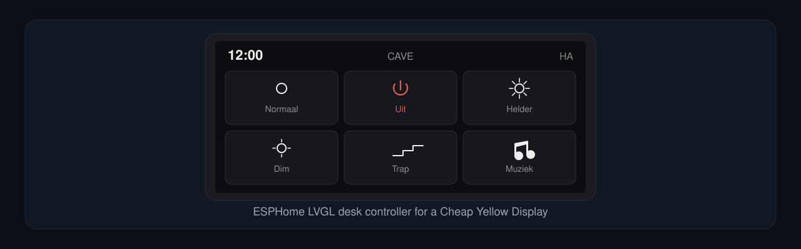

# ESP32 CYD desk controller for Home Assistant



ESPHome + LVGL firmware for a **Cheap Yellow Display** on your desk: six scene/light tiles and a now-playing page for a Home Assistant media player.

Shareable templates — **no secrets, no personal entity IDs**. Change a few substitutions and flash.

**Templates:** [`2026.09.18`](yaml/cyd-35-desk-display.yaml) ([changelog](CHANGELOG.md)) · **License:** [MIT](LICENSE)

---

## What it does

| Page | Actions |
| --- | --- |
| Scenes | Four Home Assistant **scenes**, one **light toggle** (stairs), one tile that opens music |
| Music | Artist, title, seek bar, previous / play-pause / next. Swipe back to scenes |

Also: clock from Home Assistant, HA online indicator, idle dim to 40% after 90s, wake on touch.

## Photos

No photos in the repo yet.

<!-- TODO: add a photo of the 3.5″ CYD showing the scenes page (suggested path: docs/photos/cyd-35-scenes.jpg) -->
<!-- TODO: add a photo of the 2.8″ CYD showing the scenes page (suggested path: docs/photos/cyd-28-scenes.jpg) -->
<!-- TODO: add a photo or screenshot of the music / now-playing page (suggested path: docs/photos/music-page.jpg) -->

| Scenes (3.5″) | Scenes (2.8″) |
| --- | --- |
| *TODO: photo of the 3.5″ desk display showing the six scene tiles.* | *TODO: photo of the 2.8″ desk display showing the six scene tiles.* |

| Music page | |
| --- | --- |
| *TODO: photo or screenshot of the now-playing page (artist, title, seek bar, previous / play-pause / next).* | |

Alt text to use when the files are added:

- `ESP32-3248S035 Cheap Yellow Display on a desk, showing six Home Assistant scene tiles.`
- `ESP32-2432S028 Cheap Yellow Display on a desk, showing six Home Assistant scene tiles.`
- `CYD desk controller music page with artist, title, seek bar and playback buttons.`

## Requirements

- Home Assistant with the **ESPHome** add-on (or ESPHome CLI)
- ESPHome **2026.4.0** or newer (`esp-idf` framework)
- A matching CYD board (see the boards table below)
- Wi-Fi, and API encryption + OTA secrets (below)

## Boards

| Size | File | Board | Display |
| --- | --- | --- | --- |
| **3.5″** | [`yaml/cyd-35-desk-display.yaml`](yaml/cyd-35-desk-display.yaml) | ESP32-3248S035 / ESP32-035 | ST7796, 480×320 |
| **2.8″** | [`yaml/cyd-28-desk-display.yaml`](yaml/cyd-28-desk-display.yaml) | ESP32-2432S028 / 2432S028R | ILI9341, 320×240 |

Both boards are ESP32-WROOM (**no PSRAM**). Album art is intentionally omitted.

## Install

### 1. Copy the right YAML

1. Open the file for your board (3.5″ or 2.8″).
2. In Home Assistant: **ESPHome** → **New device** → **New configuration**, paste the YAML (or drop the file in `/config/esphome/`).
3. Do **not** flash yet — first edit substitutions and secrets.

### 2. Point it at *your* Home Assistant entities

At the top of the YAML:

```yaml
substitutions:
  device_name: cyd-35
  friendly_name: "Desk Display"
  room_name: "CAVE"                      # header label
  media_player_id: media_player.spotify  # your player
  scene_normal: scene.normal
  scene_off: scene.off
  scene_bright: scene.bright
  scene_dim: scene.dim
  light_stairs: light.stairs             # any toggleable light
  ap_password: "changeme"                # fallback AP password
```

How to find IDs: Home Assistant → **Developer tools** → **States**. Copy the `entity_id`.

| Substitution | What it should be |
| --- | --- |
| `media_player_id` | Spotify, Music Assistant, Chromecast, … (`media_player.*`) |
| `scene_normal` / `_off` / `_bright` / `_dim` | Your scene entity IDs. Create scenes first if you don’t have them. |
| `light_stairs` | Any `light.*` (or change the action in YAML if you use a switch) |
| `room_name` | Short name on the home screen |
| `ap_password` | Password for the Wi-Fi fallback hotspot (change `changeme`) |

Tile **labels** (Normaal, Uit, Helder, Dim, Trap, Muziek) are Dutch. Skip this paragraph if you want to keep those labels. Search the YAML for `text: "Normaal"` and the other labels if you want English (or another language).

### 3. Secrets (do not commit these)

Put this in Home Assistant `secrets.yaml` (ESPHome add-on uses `/config/esphome/secrets.yaml` or `/config/secrets.yaml`). Example: [`secrets.yaml.example`](secrets.yaml.example).

**3.5″ board**

```yaml
wifi_ssid: "YourWiFi"
wifi_password: "YourWiFiPassword"
cyd_35__encryption_key: "paste_base64_key_here"
cyd_35__ota_password: "choose_a_strong_password"
```

**2.8″ board** — same Wi-Fi keys, but:

```yaml
cyd_28__encryption_key: "paste_base64_key_here"
cyd_28__ota_password: "choose_a_strong_password"
```

Generate an API key (Home Assistant **ESPHome** UI does this, or):

```bash
openssl rand -base64 32
```

If you already have a device named `cyd-35` / `cyd-28`, keep the existing encryption key or HA will refuse the API connection.

### 4. Flash

1. Save the YAML in ESPHome.
2. **Install** → USB the first time, OTA after that.
3. In Home Assistant: **Settings** → **Devices** → you should see the display. Enable it if asked.

## Board notes

### 3.5″ — `cyd-35-desk-display.yaml`

- Display: ST7796, LVGL rotation 90° → 480×320
- Backlight: GPIO27
- Touch: XPT2046 on the **same** SPI bus as the TFT
- Recalibrate if your panel differs (`touchscreen` → `calibration` / `transform`)

### 2.8″ — `cyd-28-desk-display.yaml`

- Display: ILI9341, LVGL rotation 90° → 320×240
- Backlight: **GPIO21** (not 27)
- Touch: XPT2046 on a **separate** SPI bus (CLK 25, MOSI 32, MISO 39)
- Some AliExpress boards use **ILI9342**. If colours are inverted/wrong:

```yaml
    model: ILI9342
    invert_colors: true
```

- If touch is mirrored, flip `mirror_x` / `mirror_y` / `swap_xy` under `touchscreen`.

## Troubleshooting

| Symptom | Try |
| --- | --- |
| White / black screen | Wrong board YAML, or ILI9341 vs ILI9342 |
| Touch dead or inverted | Separate SPI on 2.8″; adjust `transform` |
| Device not in HA | Encryption key mismatch; check `secrets.yaml` |
| Fallback AP `CYD-35 Fallback` / `CYD-28 Fallback` | Wi-Fi credentials wrong; join the AP and use the captive portal |
| Compile error on fonts | Needs internet on first build (Google Fonts) |

## What is *not* included

- Album cover (`online_image` needs PSRAM)
- Volume slider (unreliable on these resistive panels)

## Layout

```
yaml/cyd-35-desk-display.yaml   3.5″ board template
yaml/cyd-28-desk-display.yaml   2.8″ board template
secrets.yaml.example            copy to secrets.yaml — never commit
docs/                           cover image
LICENSE                         MIT
SECURITY.md                     what never to publish
```

`secrets.yaml` is in [`.gitignore`](.gitignore).

## Do not publish

See [SECURITY.md](SECURITY.md).

- no `secrets.yaml` with a Wi-Fi password, API encryption key or OTA password
- change `ap_password` from the default `changeme` before you flash

Copy [`secrets.yaml.example`](secrets.yaml.example) to `secrets.yaml` on your machine.

## License

[MIT](LICENSE) © 2026 [Leon van Os](https://github.com/leon199219)

Hardware pinouts follow the common Sunton / “Cheap Yellow Display” boards.
